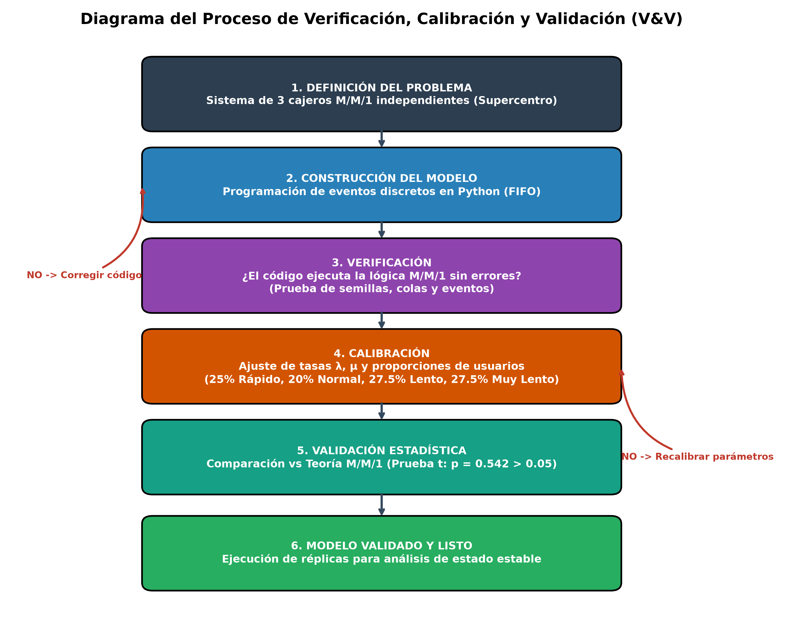
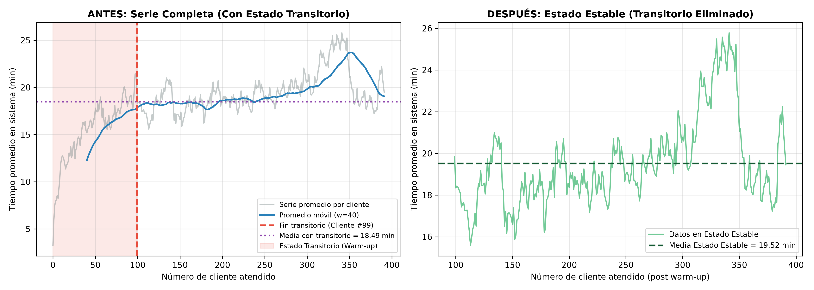
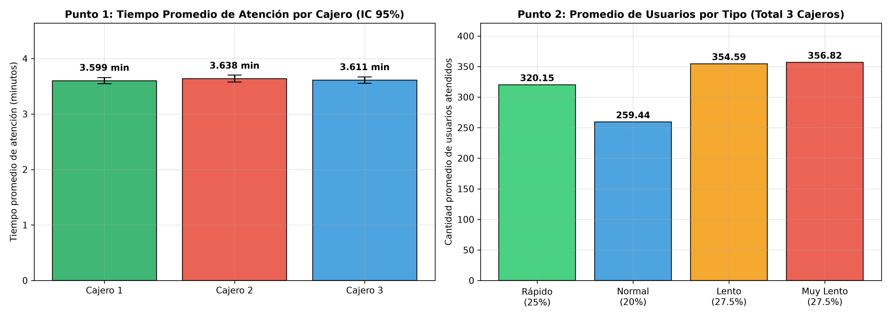
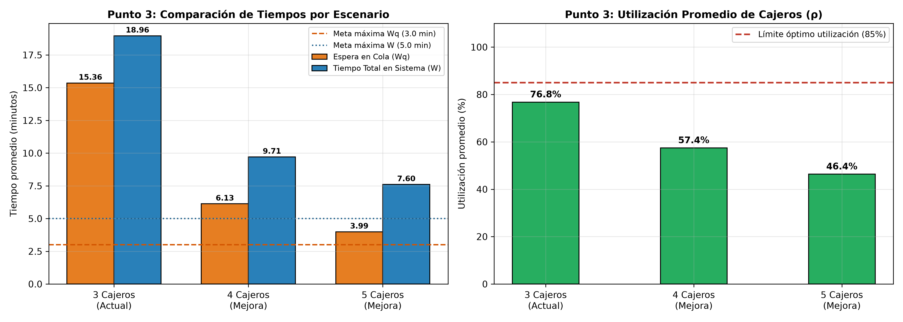

# S30 - Módulo 4. Actividad didáctica 2 Problema Parqueadero Jose hilario lopez y Dennyn Pandales

## Autores

José Hilario López y Dennyn Pandales.

## Descripción

Simulación de Parqueaderos M/M/1 – Centro Comercial Supercentro. El proyecto usa simulación de eventos discretos para analizar la atención en los cajeros del parqueadero, estimar la espera en cola y evaluar el efecto de aumentar el número de cajeros.

## Parámetros del modelo

- El escenario base tiene tres cajeros independientes, cada uno con una cola y un servidor, bajo el esquema M/M/1 de referencia.
- La disciplina es FIFO. Los usuarios se atienden en orden de llegada, sin cambio de fila ni deserción.
- Los tiempos entre llegadas son exponenciales. El tiempo de servicio es exponencial condicionado al perfil del usuario. La validación teórica M/M/1 se realiza con el perfil rápido.

| Perfil | Probabilidad | Media de llegada del perfil (min) | Media de servicio (min) |
| --- | ---: | ---: | ---: |
| Rápido | 25% | 3 | 1 |
| Normal | 20% | 3 | 3 |
| Lento | 27.5% | 5 | 4 |
| Muy Lento | 27.5% | 7 | 6 |

En el escenario base, el intervalo medio entre llegadas de cada cola se calcula como el promedio ponderado de las medias de llegada de la tabla.

## Estructura del repositorio

```text
.
├── .gitignore                         # Exclusiones de Git
├── README.md                          # Modelo, ejecución y resultados
├── requirements.txt                   # Dependencias de Python
├── simulacion_parqueadero.py          # Simulación, análisis y generación de gráficas
├── diagrama_VV.png                    # Verificación y validación
├── antes_despues_transitorio.png      # Análisis del estado transitorio
├── resultados_cajeros_usuarios.png    # Tiempos de atención y distribución de usuarios
└── estrategia_mejora_escenarios.png   # Comparación de escenarios de capacidad
```

## Ejecución

1. Instala Git y Python 3. Con una cuenta de GitHub que tenga acceso al repositorio, ejecuta:

   ```powershell
   git clone https://github.com/dennynpandales-png/S30-Modulo-4-Actividad-didactica-2-Problema-Parqueadero-Jose-Hilario-Lopez-y-Dennyn-Pandales.git
   cd S30-Modulo-4-Actividad-didactica-2-Problema-Parqueadero-Jose-Hilario-Lopez-y-Dennyn-Pandales
   ```

   Si ya tienes la carpeta del proyecto, ábrela en la terminal y continúa con el paso 2.

2. Crea el entorno virtual:

   ```powershell
   python -m venv venv
   ```

3. Instala las dependencias y ejecuta el script en PowerShell (Windows):

   ```powershell
   .\venv\Scripts\python.exe -m pip install -r requirements.txt
   .\venv\Scripts\python.exe simulacion_parqueadero.py
   ```

   En macOS o Linux, usa `python3` para crear el entorno y ejecuta:

   ```bash
   ./venv/bin/python -m pip install -r requirements.txt
   ./venv/bin/python simulacion_parqueadero.py
   ```

El script imprime las métricas en la terminal y guarda las cuatro gráficas PNG en la carpeta desde la que se ejecuta. Si aparecen ventanas de Matplotlib, ciérralas a medida que se abran para que el script continúe.

## Resultados principales

### Validación M/M/1

La prueba t del tiempo medio en el sistema del perfil rápido obtuvo **p = 0.542 > 0.05**. Con ese nivel de significancia, no se detectó una diferencia estadísticamente significativa frente al valor teórico.



### Estado transitorio

El punto de corte para eliminar el estado transitorio se ubicó en el **cliente #99**. Para el estudio definitivo se seleccionaron **n = 71 réplicas**.



### Cajeros y usuarios

El **Cajero 1** registró el menor tiempo promedio de atención, con **3.599 min**, y el **Cajero 2** registró el mayor, con **3.638 min**. Los tres cajeros sumaron **1291.00 usuarios en promedio por réplica**.



### Estrategia de mejora

En la simulación, pasar de **3 a 5 cajeros** con la misma demanda total redujo el tiempo promedio de espera en cola de **15.36 a 3.99 min (74.0%)**. Con cinco cajeros, el tiempo promedio total en el sistema fue de **7.60 min** y la utilización fue de **46.4%**. El escenario cumple el límite de utilización del 85%, pero la espera en cola y el tiempo total siguen por encima de las metas del script (menos de 3 y 5 min, respectivamente).


